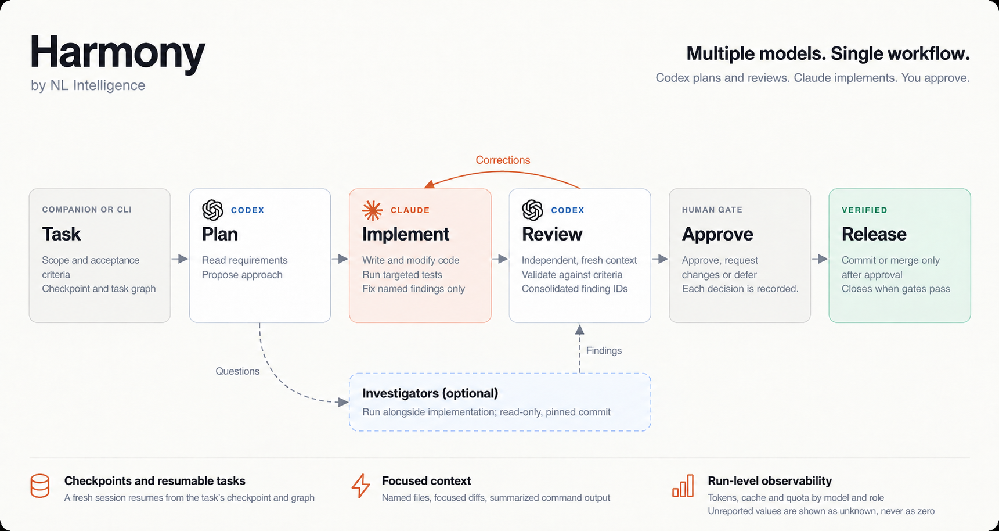
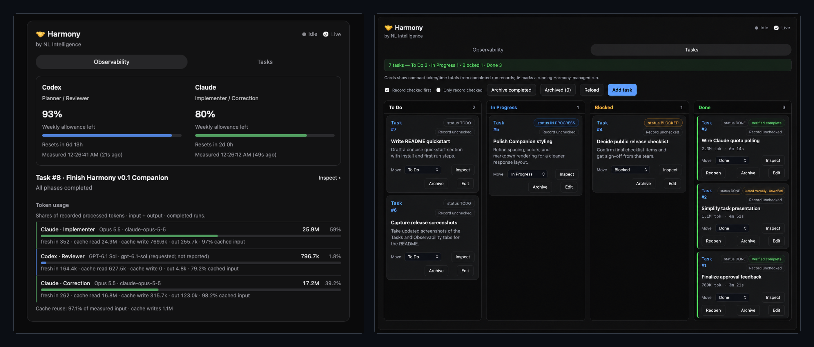
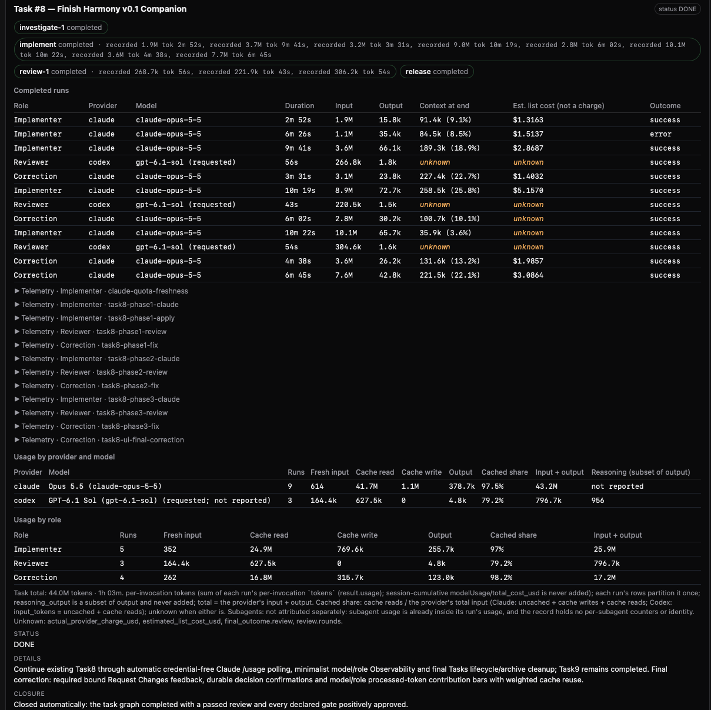

# Harmony
🤝

*by NL Intelligence*

**Better Together.**

Harmony is an open-source orchestration and observability toolkit for developers using both Claude Code and OpenAI Codex. It brings planning, implementation, review, task management, and resource visibility together, without adding another hosted platform to manage.

**Less managing. More building.**



## The best of both worlds.

A coding assistant can write a function. Building and maintaining software takes more: a clear plan, the right context, a second set of eyes, and a record of what happened when the session ends.

Harmony gives those steps a shared structure. **Codex plans and independently reviews. Claude implements and addresses the findings.** When extra investigation is useful, bounded read-only agents can work in parallel on a pinned commit, then return evidence to the workflow. One primary writer owns the changes.

The process remains deliberately controlled. Harmony records task state, dependencies, handoffs, and approvals; agents or operators explicitly launch the underlying coding CLIs. It is **not** an autonomous one-prompt development pipeline.

## Built for work that doesn't fit in one conversation

**Pick up where you left off.** Harmony's lightweight, CLM-inspired context system keeps a compact working picture of each task: decisions, constraints, evidence, and what to do next. Durable checkpoints and resumable task graphs help a new session continue without rediscovering the project.

**Spend tokens on progress, not repetition.** Selective context loading, concise agent handoffs, and a command-output summarizer keep noisy logs and unnecessary rereads out of the model's immediate context while preserving the original evidence. Focused checks and bounded correction cycles aim to avoid repeating work. Actual savings depend on the task; Harmony does not promise a particular reduction.

**Keep every task accountable.** Work has a canonical task ID, acceptance criteria, recorded runs, and a verification history. Automatic completion requires the applicable workflow checks and approvals. Manual closure is marked differently, and archived work keeps its evidence.

**See what your models actually did.** Harmony attributes measured tokens to providers, models, roles, and tasks; distinguishes fresh input, cached input, output, and estimated costs; and shows available Claude and Codex allowance readings with their measurement times. Unknown data stays unknown.

**Approve with confidence.** A human can approve, defer, or request specific changes at a bound workflow gate. Permission to commit is not permission to merge or publish, and an approval is not treated as proof that an action succeeded.

## Meet Harmony Companion

One local browser window brings the moving pieces together.

**Tasks** is a persistent Kanban board to create, edit, track, close, reopen, and archive development work. **Observability** shows measured allowance, model/role contributions, cache reuse, and the latest task. Open **Inspect** for the underlying workflow graph, run details, review evidence, and approval history.



*Harmony Companion brings task management and model observability together: track work on the Kanban board, monitor allowances, and see model-level token usage and cache reuse.*



*Inspect a task to explore its workflow, agent runs, review evidence, approval history, and detailed resource usage.*

## Install

Harmony runs its **orchestration and Companion locally**; Claude and Codex still use their own model services. You'll need macOS or Linux, Python **3.10+**, and Git. Authenticated Claude Code and Codex CLIs are required for model runs and supported allowance readings, but you can explore the board without them.

```bash
git clone https://github.com/norman8823/nl-harmony.git
cd nl-harmony
python3 -m venv .venv
. .venv/bin/activate
python3 -m pip install .
nlh --version
```

No frontend build or additional runtime Python packages are required.

**Need a command?** Browse the [CLI Command Reference](docs/cli-reference.md) for every `nlh` command, examples, and approval syntax.

### Work from any repository

For a one-time local setup from this checkout, run `bash install-local.sh`
with Python 3.11+ and a recent Codex CLI. The installer sets up a dedicated
user virtual environment and the Codex prompt hook, preserving existing
settings. It prints the full `nlh` path so shell activation and PATH changes
are not required for the integration. Restart existing Codex sessions once,
then start Companion using your existing board directory. No login, access key
or hosted service is needed. Cloud-to-local synchronization is out of scope.
When upgrading, restart Companion too, using the same board directory to retain cards.

On the first Codex launch after installation, expect **Hooks need review**.
Choose **Review hooks** and inspect **Connecting to Harmony** under
**UserPromptSubmit**. Check that its command points to your Harmony
installation's Python executable followed by `-m harmony.codex_bridge`, then
approve that hook. If Harmony is the only pending hook, **Trust all and continue**
on the initial screen also approves it. Hooks can run outside Codex's sandbox;
review any other listed hooks before trusting them.

Codex saves approval across ordinary restarts. Harmony updates preserve it when
the hook settings are unchanged; changed settings or a different installation
path may require review again. **Continue without trusting** leaves the hook
inactive, so automatic card tracking will not work.

Install the user-level Codex connection once with `nlh codex install` (a recent
Codex CLI with lifecycle hooks and Python 3.11+ are required). It preserves other
Codex hooks/settings and backs up an existing configuration. Restart already-open
Codex sessions once. With Companion running, open ordinary Codex in **any repository
on the same machine** and describe your work in natural language. The global
prompt hook directs Codex to check existing tasks before creating or continuing
a card on that Companion's board. No per-task command or Harmony checkout is
required. Look for **Created Harmony task #N** or **Continuing Harmony task #N**;
`nlh codex status` reports configuration and active boards. Multiple active boards
require selection; closing Companion leaves the hook idle. Ordinary questions
are not tasks, and follow-up prompts keep the existing card. This does not connect
separate machines automatically or bypass a project's execution permissions.
Codex updates that same card to In Progress while working and Blocked when
waiting, then calls `complete_task` when the requested work is finished. A turn
ending is not completion. Declared completion gates remain enforced; simple
cards show Completed by Codex with its summary, without an additional Companion review.

## Five-minute walkthrough

Start with a sample project so you can try the interface:

```bash
demo_dir="$(mktemp -d /tmp/harmony-demo.XXXXXX)"
cd "$demo_dir"
git init -q
printf '.workflow/\n.direct-runs/\nharmony.json\n' > .gitignore
cat > harmony.json <<'JSON'
{
  "workflow_dir": ".workflow",
  "runs_dir": ".direct-runs",
  "board": {"port": 8765}
}
JSON
nlh companion --no-browser --port 0
```

Open the printed local URL. Under **Tasks**, choose **Add task** and create `Write a greeting`, with details `Add a tiny greeting function and a focused test.` Try editing, Inspect, Mark Done, and Reopen. These board actions **do not authorize a code release**.

Stop Companion with **Ctrl-C**. The task record remains in `.workflow/tickets/`. You can inspect it from the CLI:

```bash
nlh task resolve --task-id 1
nlh inspect 1
```

The empty project is intentional: no model is invoked or charged simply by starting Companion.

## How the workflow runs

Harmony supplies durable records and checked commands; your agents or scripts invoke them. A typical task moves through **plan → implement → independent review → targeted correction (if needed) → human decision → verified action**.

**1. Establish the task and its context.** Define acceptance criteria and obtain execution authorization in the canonical ticket. The checkpoint keeps a compact handoff; the graph tracks allowed phases and bounded parallel investigation.

```bash
D="$(python3 -c 'from pathlib import Path; import harmony; print(Path(harmony.__file__).parent / "direct-workflow")')"

python3 "$D/task_checkpoint.py" update --task-id 1 \
  --phase planning --next-action "Define acceptance criteria"
python3 "$D/task_graph.py" init --task-id 1 \
  --investigators 0 --correction-ceiling 1
python3 "$D/task_graph.py" status --task-id 1
```

**2. Record work by role.** Once a task is authorized, `nlh record` captures machine-readable execution and attributes the result to its existing task ID. The commands below illustrate the explicit handoffs; prepare the referenced prompt files and use your supported model identifiers.

```bash
nlh record --task-id 1 --role planner -- \
  codex exec --json --sandbox read-only -m YOUR_CODEX_MODEL - < plan.md

export HARMONY_PR_GUARD="$D/direct-workflow-pr-guard.py"
nlh record --task-id 1 --role writer -- \
  claude -p "Implement the approved task" --model opus \
  --output-format stream-json --verbose \
  --settings "$D/release-settings.json"

nlh record --task-id 1 --role reviewer -- \
  codex exec --json --sandbox read-only -m YOUR_CODEX_MODEL - < review.md
```

Corrections return only the named review findings to the writer; the reviewer checks the resulting delta. Optional investigators use a pinned `--base-commit` and read-only isolation. Their findings must be recorded before review can start. The graph constrains execution; **it does not automatically spawn agents or choose models**.

**3. Request a decision, then prove the outcome.** When the required graph steps and review pass, the executing agent can request approval for a *specific* final action:

```bash
nlh approval request 1 --action commit \
  --summary "Verified local changes ready to commit" \
  --evidence evidence/verification.md
nlh approval show 1 --json
```

The human approves, requests changes with feedback, or defers. If approved, the agent must perform the action, verify it, and record evidence using `nlh approval execute`. Commit, merge, and publish are separate permissions; the Companion backend performs none of them itself.

For more on CLI options, use `nlh --help`, `nlh record --help`, and the in-repository [workflow](harmony/direct-workflow/README.md) and [Companion/approval](harmony/task-board/README.md) guides.

## What's measured (and what isn't)

Harmony keeps **per-invocation token totals** separate from session-cumulative data so runs aren't double-counted. It records model identities when reported, qualifies a Codex model when only the requested name is known, and treats unreported values as unknown rather than zero. Cache reuse describes measured input, **not money saved**. API-equivalent estimates are not subscription charges.

Weekly allowance comes from different provider interfaces: Codex's app-server seven-day rate limits and Claude Code's authenticated native `/usage` view, checked locally about every five minutes. Claude's terminal display is not a versioned API, so parsing may fail; stale readings keep their original timestamps. Disable collection with `HARMONY_CODEX_QUOTA=0` or `HARMONY_CLAUDE_CLI_QUOTA=0` if needed.

Task state, checkpoints, approval evidence, and run records stay in local `.workflow/` and `.direct-runs/` directories. Keep those paths, local configuration, and credentials out of Git. Harmony has no required cloud dashboard or billing service.

**Harmony is a toolkit for coordinating the agents you already use.**

**Better Together.**

## Questions?

[Read the FAQ](docs/faq.md)

## License

[MIT](LICENSE) · © 2026 NL Intelligence

### About NL Intelligence

NL Intelligence is an independent applied AI lab building practical tools and solutions to solve real-world problems.

Harmony is an open-source project by NL Intelligence.
